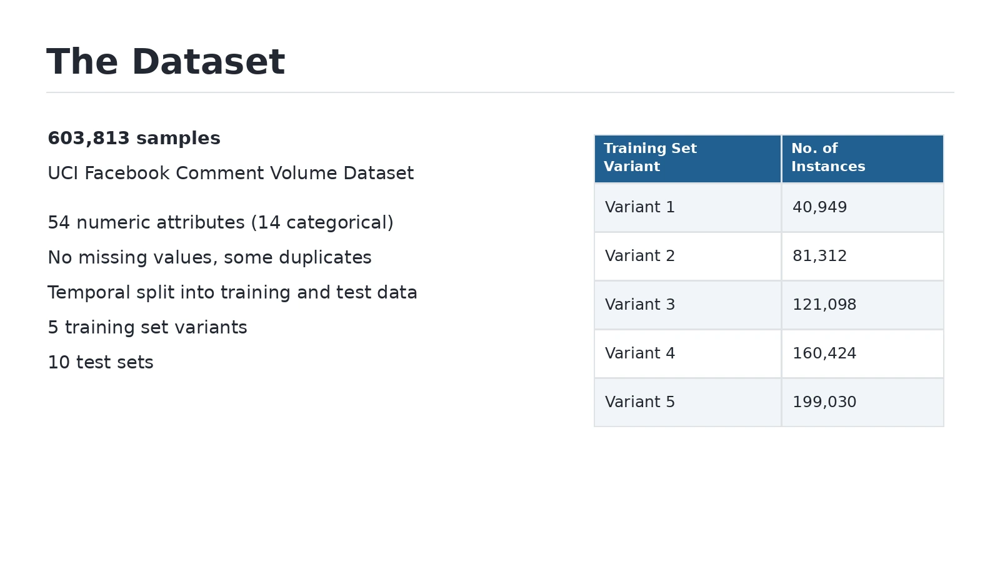

# Facebook Comment-Volume Prediction

How many comments will a Facebook post receive within a given time window? This project studies comment-volume prediction as a regression problem, using page characteristics, post information, and previous comment activity as inputs.

The analysis compares linear, tree-based, and neural-network models, with attention to data preparation, prediction error, and computation time.

**Methods:** Lasso regression, gradient boosting, random forests, multilayer perceptron, principal component analysis

## Dataset overview

The source material describes 54 input features and multiple dataset variants. The prediction target is the number of comments a post receives during a specified future interval.

## Analysis workflow

- Examined missing values, duplicate records, and constant or redundant features
- Standardized features for the modeling workflow
- Explored a four-component representation using principal component analysis
- Compared Lasso, gradient boosting, random forest, and multilayer perceptron models
- Evaluated prediction error and runtime across five dataset variants

The comparison examines how model choice and data preparation affect the prediction of a numeric engagement measure. It also considers the cost of fitting and evaluating the models.

## Models compared

| Model | Role in the comparison |
| --- | --- |
| Lasso regression | A regularized linear approach that can reduce the influence of less useful features |
| Gradient boosting regressor | An ensemble that fits successive trees to improve predictions |
| Random forest regressor | An ensemble of trees that captures nonlinear relationships |
| Multilayer perceptron | A neural-network approach to regression |

## Materials

The project report describes the preprocessing steps, model comparisons, and evaluation. The dataset slide provides a compact overview of the inputs and data variants.

The report and presentation are the available documentation for this version. Training code and a pinned environment are needed to make the experiments reproducible; no training command is supplied here without those files.

## Interpreting the results

The task predicts a count, so regression error measures are more informative than a general “accuracy” percentage. Results should be compared under the same preprocessing, train/test partition, and evaluation definition.

## Related work

[Project background and other work](https://sidharth-dinesh.github.io/) · [GitHub profile](https://github.com/Sidharth-Dinesh)
